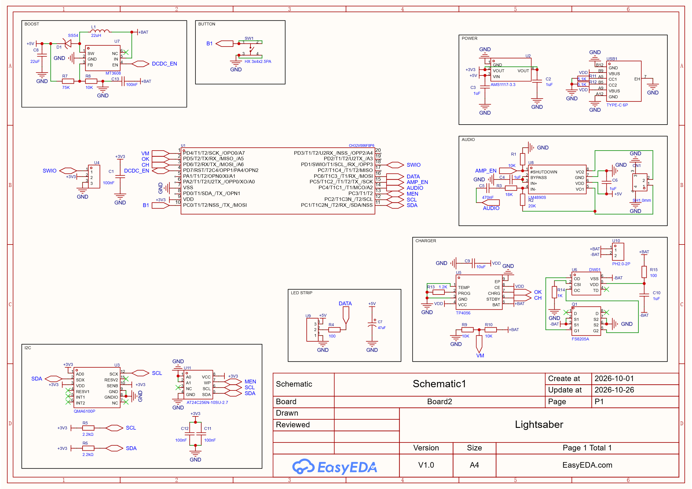
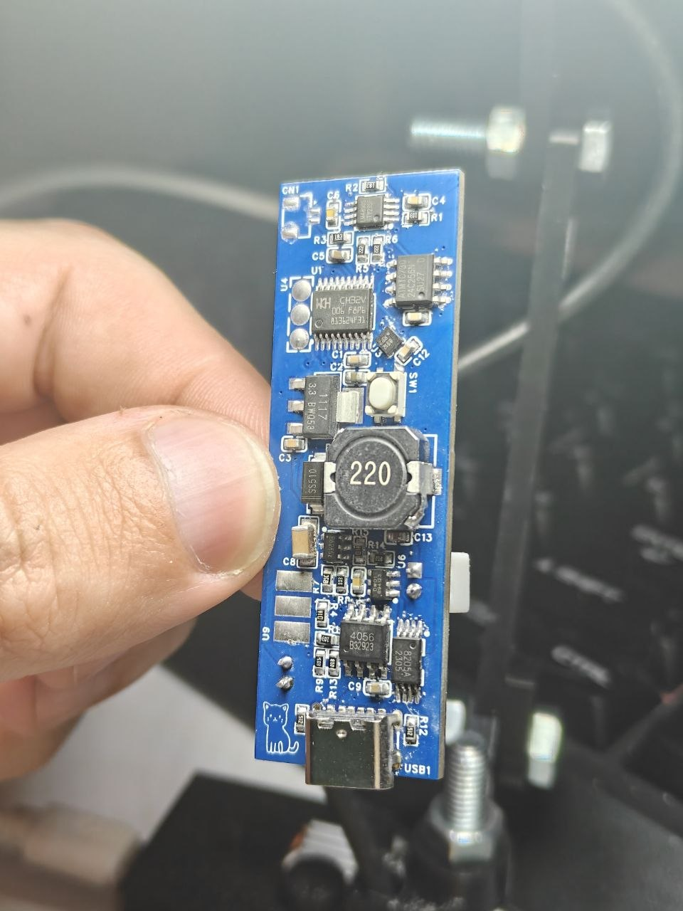

# Low cost lightsaber project

A handheld light sword powered by a CH32V006 RISC-V MCU, featuring a procedurally animated WS2812B LED blade, PWM audio playback, gesture control via a QMA6100P accelerometer, and EEPROM storage for audio samples and LED presets. Powered by a single 18650 cell with on-board TP4056 charging, protection, and MT3608 boost conversion.


## HARDWARE

| Subsystem | Part     | Interface / Notes              |
| :-------- | :------- | :------------------------- |
| `MCU` | `CH32V006F8P6` | — |
| `Blade` | `WS2812B strip, 120 LED/m` | SPI (MOSI) |
| `Motion` | `QMA6100P` | I2C, polling (INT not routed) |
| `Audio` | `LM4890S` | PWM, 7× oversampling |
| `Storage` | `AT24C256 EEPROM` | I2C |
| `Power` | `18650, TP4056(DW01+FS8205A), MT3608` | Charging(protection) + Boost |
| `Control` | `HX 3x4x2.5PA` | Additional for gesture control |


## Features

- Gesture-controlled light sword behavior
- Procedurally generated blade animations
- Synchronized built-in sound effects
- On-device LED preset and audio sample storage
- Gesture controls
- Standalone use — no app required
- Real-time motion-reactive feedback
- Low-latency bare-metal response
- Self-contained 18650 power with onboard charging
- Custom PCB-based handheld design


## Schematic



### Pinout
- PC0 — Button (to GND): GPIO input. Can use an falling-edge interrupt if desired.
- PC1 — I2C SDA.
- PC2 — I2C SCL.
- PC3 — EEPROM EN.
- PC4 — Audio out (PWM): use TIM1_CH4 as the default PWM output.
- PC5 — Amp EN.
- PC6 — LED data (MOSI).
- PD1 — SWIO.
- PD5 — TP4056 STDBY: GPIO input.
- PD6 — TP4056 CHRG: GPIO input.
- PD7 — DCDC EN.

**Important**
NRST must be disabled in the USER option bytes; otherwise the system is not stable.
```c
FLASH_Unlock();
FLASH_UserOptionByteConfig(OB_IWDG_SW, OB_STOP_NoRST, OB_STDBY_NoRST, OB_RST_NoEN, OB_PowerON_Start_Mode_USER);
FLASH_Lock();
```
## Roadmap
☑️ Custom PCB designed, manufactured, and tested

☑️ SPI transmission to WS2812B LEDs works, but stability is not final

☑️ QMA6100P initializes over I2C

☑️ Audio format defined: 22050 Hz, 8-bit, no jittering, bin2header conversion required

☑️ Basic hardware platform assembled and powered
Remaining

🔳 Design and fabricate the enclosure

🔳 Integrate QMA6100P gesture detection into the firmware (polling-based, since INT pins are not routed)

🔳 Refactor the firmware architecture

🔳 Perform real-load testing — to determine peak and stable values

🔳 Run system-level stability and gesture-response testing

🔳 Finalize the audio import/playback pipeline, including bin2header conversion and no-jitter playback

🔳 Test EEPROM read/write and integrate storage for LED presets and audio samples
## Images

